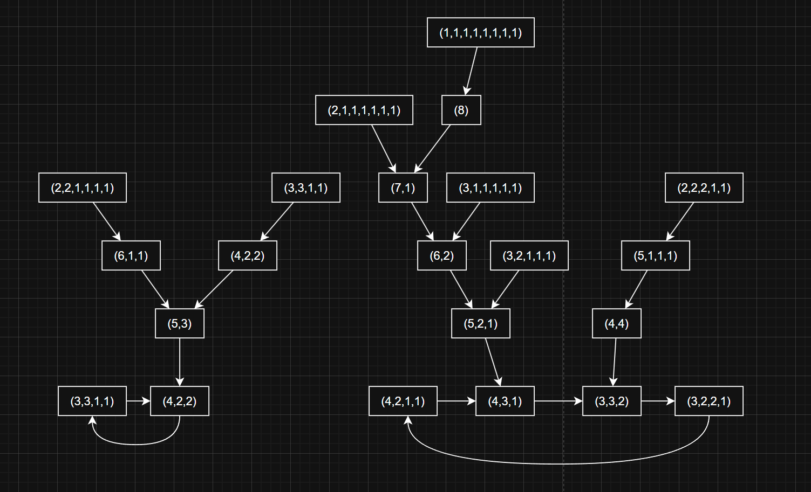

# Bulgarian Solitaire Graphs

Bulgarian solitaire takes a partition of n (piles of cards), removes one card from every pile and stacks the removed cards into a new pile. Iterating this map on every integer partition of n gives a functional graph whose cycles are the attractors of the game (for triangular n the unique fixed point is the staircase partition). The code enumerates all partitions of n with Knuth's algorithm (TAOCP vol. 4, fasc. 3), builds the graph as a `networkx.DiGraph`, and draws it with a planar layout refined by a custom force-directed relaxation that repels nodes from edges as well as from each other.

## How to run
Python 3 with `networkx` and `matplotlib`. Open `bulgarian_solitatire.ipynb` (or run `graph.py` as a script) and call `plot_partition_graph(n)`; `animate_relaxation` shows the layout settling.

## Notes
- `Bulgarian_Solitaire_n=15.svg` is the graph for n = 15; `graph.graphml` and the `.drawio` file are exports of the n = 8 graph for external editing.
- Partition counts grow fast (p(15) = 176, p(30) = 5604), so the layout step becomes slow beyond n of about 20.
